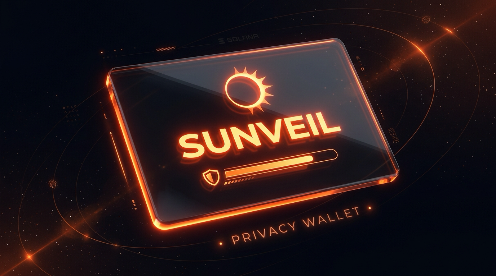

<p align="center">
  
</p>

<h1 align="center">SUNVEIL</h1>

<p align="center">
  <strong>Private Solana. Zero Custody.</strong><br/>
  Obsidian &amp; neon-orange non-custodial pocket wallet and private X pay links built independently on <a href="https://github.com/helius-labs/privacy-rings">Helius Solana Privacy Rings</a>.
</p>

<p align="center">
  <a href="https://x.com/SunVeilSol"></a>
  
  
  
</p>

---

## Overview

**SUNVEIL** is an open-source, client-side web wallet designed for everyday confidential payments on Solana:

- **100% Non-Custodial Browser Vault** — Signing (`Ed25519`), Nullifier, and Viewing (`X25519`) keys are derived strictly inside your browser via `@heliuslabs/spr` and encrypted locally with WebCrypto **AES-256-GCM** (PBKDF2-SHA256, 210,000 iterations). Zero keys ever leave your device.
- **Confidential Transfers (Groth16)** — Shield public SOL into encrypted UTXOs, send confidential transfers where amounts and asset types stay encrypted onchain, and unshield back to any public Solana address.
- **Private X Pay Links & QR Cards** — Generate shareable pay links (`?pay=<address>&handle=<handle>&amount=<sol>`) and neon-orange QR cards for X bios, bounties, and creator tips.
- **Selective Disclosure** — Export your read-only **Viewing Public Key** for accounting or audits without ever exposing spend authority.
- **Zero-Risk Sandbox + Live Helius Devnet** — Explore the full UI immediately in Sandbox mode, or plug in a free Helius Devnet API key to run live Privacy Rings transactions via the unified Helius RPC, Photon indexer, and attested TEE Groth16 prover.

---

## Privacy Model (Default Ring)

| Property | Standard Solana | SUNVEIL (Default Privacy Ring) |
| --- | --- | --- |
| Transfer amount | Public on Solscan | **Encrypted onchain (Groth16)** |
| Asset type | Publicly visible | **Encrypted onchain** |
| Shielded balance | Visible to anyone | **Decryptable only with Viewing Key** |
| Compliance / Tax proof | All or nothing | **Read-only Viewing Key** |
| Key custody | Self-custodial | **100% local in-browser (AES-256-GCM)** |

---

## Tech Stack

- **Protocol SDK:** [`@heliuslabs/spr`](https://github.com/helius-labs/privacy-rings) & [`@solana/kit`](https://github.com/anza-xyz/kit)
- **Frontend:** React 19, TypeScript, Vite 6, Tailwind CSS v4
- **Local Encryption:** Native Browser Web Crypto API (`PBKDF2` + `AES-GCM-256`)

---

## Quick Start (Local Development)

Requires **Node.js 22.12+ / 24+**.

```bash
npm install
npm run dev
```

Build for production:

```bash
npm run build
```

---

## Security & Disclaimer

- SUNVEIL is an **independent open-source community project** built on the public Helius Solana Privacy Rings protocol. It is **not affiliated with Helius Labs**.
- Currently intended for **Sandbox & Solana Devnet** testing. Do not store large mainnet funds in un-audited early-stage software.

---

## Follow the Build

Follow updates, feature polls, and live demos on X: **[@SunVeilSol](https://x.com/SunVeilSol)**
